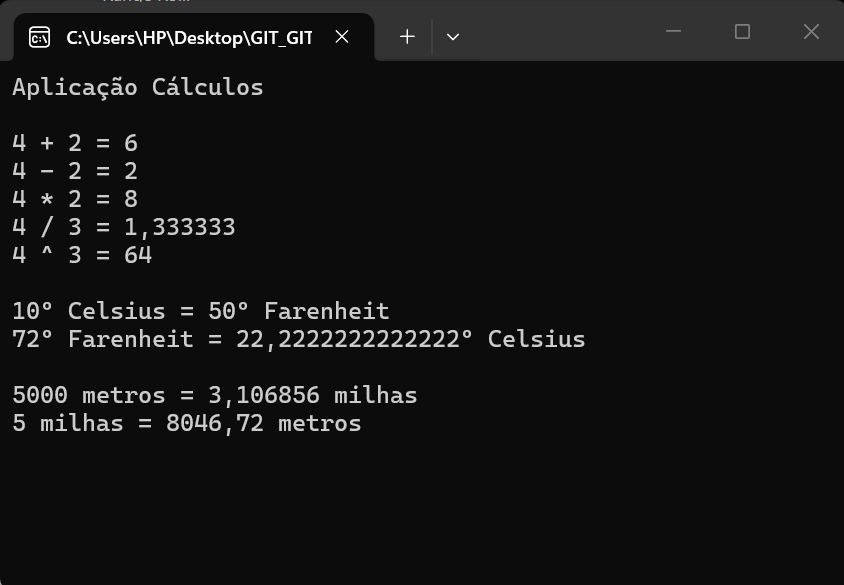

# Cálculos :1234:
Aplicação C# para efetuar vários tipos de cálculos

Desenvolvida no âmbito da ação de formação **Introdução o GIT/GitHub**
## Operações Suportadas
Implementa as seguinte operações:
- Aritméticas
    - Soma
    - Subtração
    - Multiplicação
    - Divisão
    - Potência
- Conversões
    - Temperatura
        - Celsius :arrow_right: Fahrenheit
        - Fahrenheit :arrow_right: Celsius
    - Distância
        - Metros :arrow_right: Milhas
        - Milhas :arrow_right: Metros
## Tecnologias utilizadas neste projeto

- Visual Studio
- C#
- Git
- GitHub Desktop
- Plataforma GitHub
- Visual Code
- Markdown

## Site Oficial

Aplicação baseada [neste desenvolvimento](https://github.com/joaomartiniano/calculos)